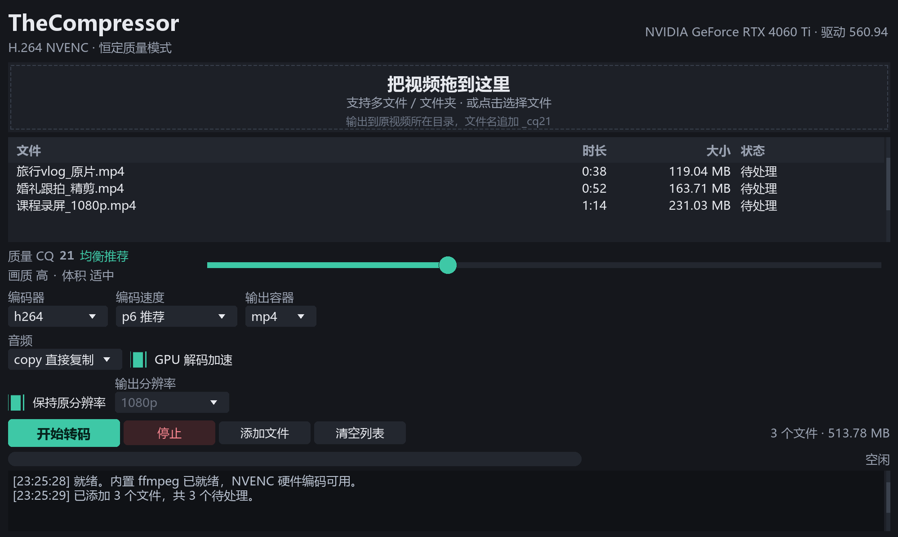

# TheCompressor

> 把「画质损失多少」变成一个滑块，剩下的交给显卡。



---

## 这是什么 / What it is

**中文**

一个 Windows 上的批量视频压缩小工具。把视频拖进虚线框，选一个画质档位，点开始，输出就放在原文件旁边，文件名带 `_cq21` 后缀。

压缩用的是显卡自带的硬件编码器——NVIDIA 走 NVENC，Intel 核显或 Arc 走 QSV，程序启动时自己判断。速度通常是 CPU 软编的 5～15 倍：一条 52 秒的 1080p 素材 5 秒压完。

**English**

A small batch video compressor for Windows. Drop your files into the dashed area, pick a quality level, hit start. Output lands next to the original with a `_cq21` suffix.

Encoding runs on the GPU's dedicated hardware encoder — NVENC on NVIDIA cards, QSV on Intel iGPU or Arc, detected automatically at startup. It is typically 5–15× faster than CPU encoding: a 52-second 1080p clip finishes in about 5 seconds.

---

## 为什么不用码率 / Why not bitrate

**中文**

剪辑软件导出时让你填的是码率（Mbps / Kbps）。码率是「每秒塞进去多少数据」，它不知道视频里有什么：镜头静止的素材按 15 Mbps 导出，大半码率都浪费了；大动态的画面同样的 15 Mbps 又不够用，糊成一片。

恒定质量（CQ / CRF）反过来做：先定「允许多大的失真」，文件大小由画面内容自己决定。简单的画面自动少给数据，复杂的画面自动多给。同一个数值，适用于所有素材，你不用为每条片子重新算码率。

**English**

Editing software asks for a bitrate (Mbps / Kbps). Bitrate is "how many bits per second", and it has no idea what is in the video: a mostly static clip exported at 15 Mbps wastes most of that budget, while a high-motion clip at the same 15 Mbps falls apart.

Constant quality (CQ / CRF) works the other way: you set how much distortion is acceptable, and the file size follows the content. Simple frames get fewer bits, busy frames get more, automatically. One number works for every clip, and you never re-estimate a bitrate per file.

---

## 功能 / Features

**中文**

1. 拖文件、拖文件夹都行，文件夹会递归收集里面的视频，支持二十多种容器格式。
2. 启动自动识别显卡，NVIDIA 用 NVENC，Intel 用 QSV；自检没通过时会自动换到另一家可用的硬件编码器，并把原因写进日志。
3. CQ 滑块 16～30，滑块下方实时显示「画质档位 / 体积档位」，不用背参数。
4. H.264 和 HEVC 可选，同画质下 HEVC 体积约小 30%。
5. 可选把 4K 降到 2K / 1080p / 720p 等档位，等比缩放，竖屏素材同样适用。
6. GPU 解码开关，4K 素材更省 CPU，不适用时自动回退。
7. 批量排队，进度条给百分比、已转时长、倍速和剩余时间，日志逐条记录每个文件的编码参数。
8. 单个 exe，内置 ffmpeg，不需要另外装环境，也不写注册表。
9. 设置自动记住，下次打开还是上次的档位。

**English**

1. Drop files or entire folders — folders are scanned recursively for videos, 20+ container formats supported.
2. GPU detected at startup: NVENC on NVIDIA, QSV on Intel. If the self-test fails, it falls back to the other available hardware encoder and says why in the log.
3. CQ slider from 16 to 30, with live "quality level / size level" hints underneath, so you never need to memorise the numbers.
4. H.264 or HEVC — HEVC is roughly 30% smaller at the same quality.
5. Optional downscale to 2K / 1080p / 720p and more, aspect ratio preserved, portrait video included.
6. GPU decoding toggle for 4K footage, with automatic fallback when it does not apply.
7. Batch queue with percentage, elapsed video time, speed multiplier and ETA, plus a per-file log line showing the exact encoder settings.
8. A single exe with ffmpeg bundled — no runtime to install, nothing written to the registry.
9. Settings are remembered between launches.

---

## 快速开始 / Quick start

**中文**

1. 到 [Releases](../../releases) 下载 `TheCompressor.exe`，双击运行（首次启动会自解压内置 ffmpeg，两秒左右）。
2. 把视频拖进虚线框，或者点虚线框用文件对话框选。
3. CQ 先留在 21 试一条，觉得画质不够就往左滑，觉得文件太大就往右滑。
4. 点「开始转码」。跑完在列表的「状态」列看结果，比如 `完成 省 60%`。

**English**

1. Grab `TheCompressor.exe` from [Releases](../../releases) and double-click it (the bundled ffmpeg unpacks itself on first launch, about two seconds).
2. Drag your videos into the dashed area, or click it to use a file dialog.
3. Leave CQ at 21 for the first clip — slide left if quality is not enough, right if the file is still too big.
4. Hit **Start**. The status column reports the result, e.g. `完成 省 60%` (done, 60% smaller).

---

## CQ 值怎么选 / Choosing a CQ value

| CQ | 中文 | English |
| --- | --- | --- |
| 16 | 极致画质，体积最大 | Maximum quality, largest files |
| 17–18 | 高画质 | High quality |
| 19–20 | 偏画质 | Quality-leaning |
| 21–23 | 均衡，推荐 | Balanced, recommended |
| 24–25 | 偏体积 | Size-leaning |
| 26–27 | 小体积 | Small files |
| 28–30 | 最小体积 | Smallest files |

**中文**

默认 21，对标 `x265 -crf 21`。归档素材用 18～20，发到网上给人看的用 23～25，只是想省硬盘的用 26 以上。数值每加 6，文件大约小一半，画质下降开始变得肉眼可见。

**English**

The default is 21, equivalent to `x265 -crf 21`. Use 18–20 for material you want to archive, 23–25 for clips you upload and watch on a screen, 26+ when you just want the disk space back. Every +6 in CQ roughly halves the file size, and the quality loss starts to become visible.

---

## 实测 / Benchmarks

**中文**

同一段素材，CPU 软编和硬件编码的对比：

| 编码方式 | 体积 | 速度 |
| --- | --- | --- |
| x265 `-crf 21` | 9.15 MB | 1.45x 实时 |
| NVENC `-cq 21` | 9.45 MB | 4.52x 实时 |

体积只差 3%，速度差三倍多。

批量测试（三条 1080p 素材）：513.78 MB → 233.73 MB，省 55%，19 秒跑完，平均 8.6x。
单条测试（52 秒婚礼跟拍，163.71 MB）：→ 66.00 MB，省 60%，5 秒，9.3x。

测试机是一张 RTX 4060 Ti，换别的显卡速度会不一样。

**English**

Same source clip, CPU encoding versus the hardware encoder:

| Encoder | Size | Speed |
| --- | --- | --- |
| x265 `-crf 21` | 9.15 MB | 1.45× realtime |
| NVENC `-cq 21` | 9.45 MB | 4.52× realtime |

3% larger, more than three times faster.

Batch run (three 1080p clips): 513.78 MB → 233.73 MB, 55% smaller, 19 seconds, 8.6× average.
Single clip (52 s wedding footage, 163.71 MB): → 66.00 MB, 60% smaller, 5 seconds, 9.3×.

Measured on an RTX 4060 Ti; other cards will be faster or slower.

---

## 系统要求 / Requirements

**中文**

- Windows 10 / 11，64 位。
- 显卡：NVIDIA Maxwell 及以后（GTX 900 系列起），或 Intel 六代核显及以后（含 Arc 独显）。
- 显卡驱动建议用近两年的版本，老驱动可能开不起硬件编码器。
- 不需要单独安装 ffmpeg。
- AMD 显卡暂不支持。

**English**

- Windows 10 / 11, 64-bit.
- GPU: NVIDIA Maxwell or newer (GTX 900 series onward), or Intel 6th-gen iGPU or newer, including Arc.
- A recent GPU driver — old drivers often fail to open the hardware encoder.
- No separate ffmpeg installation needed.
- AMD GPUs are not supported yet.

---

## 从源码构建 / Build from source

**中文**

需要 Python 3.11 和 PyInstaller。ffmpeg.exe 没有进仓库，构建前把它放到 `nv_compressor.spec` 同目录（建议 gyan.dev 的 essentials build，需要包含 `h264_nvenc` / `h264_qsv` / `hevc_qsv`）。

```
pip install -r requirements.txt
pyinstaller --noconfirm --clean nv_compressor.spec
```

产物在 `dist/TheCompressor.exe`。

**English**

Requires Python 3.11 and PyInstaller. `ffmpeg.exe` is not committed — place it next to `nv_compressor.spec` before building (the gyan.dev essentials build works; it must include `h264_nvenc` / `h264_qsv` / `hevc_qsv`).

```
pip install -r requirements.txt
pyinstaller --noconfirm --clean nv_compressor.spec
```

The result is `dist/TheCompressor.exe`.

---

## 已知限制 / Known limitations

**中文**

- AMD AMF 还没做，之后会加。
- HDR 素材保留 10bit 和色彩标记，但不做 HDR→SDR 色调映射，在 SDR 屏幕上会偏灰。
- MP4 容器不写字幕轨，要保留字幕请选 MKV。
- Intel 的 H.264 编码器不支持 10bit，10bit 素材会被压成 8bit；HEVC 保留 10bit。
- Intel QSV 的 `-global_quality` 与 NVENC `-cq` 的画质对齐只在小样本上调过，大样本还需要更多反馈。
- exe 没有代码签名，个别杀毒软件第一次运行会拦一下。
- 输出不删除原文件。

**English**

- AMD AMF is not implemented yet.
- HDR footage keeps its 10-bit and colour tags, but there is no HDR→SDR tone mapping, so it looks washed out on SDR screens.
- MP4 does not carry subtitle tracks — use MKV if you need them.
- Intel's H.264 encoder is 8-bit only, so 10-bit sources are converted; HEVC keeps 10-bit.
- QSV's `-global_quality` has only been aligned against NVENC's `-cq` on a small sample; more data is welcome.
- The exe is not code-signed, so some antivirus tools will flag it on first run.
- Originals are never deleted.

---

## 第三方组件 / Third-party components

**中文**

内置的 ffmpeg 来自 gyan.dev 的 essentials build，按其 GPL 条款分发。本仓库的代码是 MIT。

**English**

The bundled ffmpeg is the gyan.dev essentials build and is distributed under its GPL terms. The code in this repository is MIT.

---

## 许可 / License

**中文**

MIT，见 [LICENSE](LICENSE)。

**English**

MIT, see [LICENSE](LICENSE).
